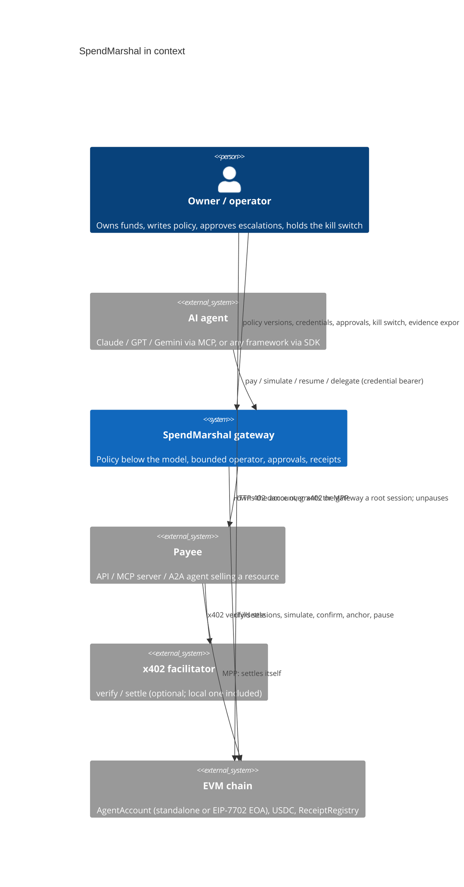
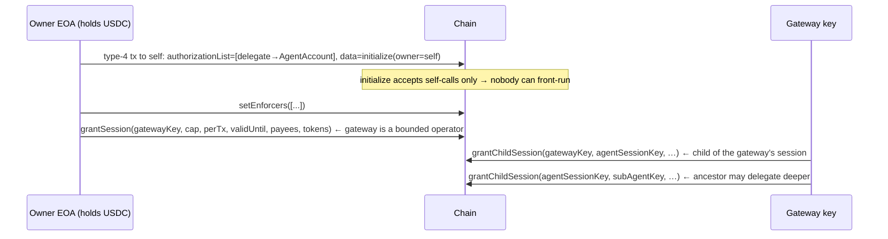
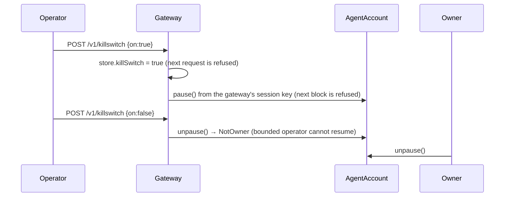

# Architecture (Phase 1)

## Context



## Containers

```mermaid
flowchart LR
  subgraph Agent side
    A[Agent / MCP client] -->|SDK: pay() · resume()| GW
  end
  subgraph SpendMarshal gateway
    GW[HTTP API] --> POL[Policy engine<br/>deny rules → caveats (+rate_limit) → lineage caps → budgets w/ periods → velocity → escalate → allow]
    GW --> VER[Policy versions<br/>diff · impact · receipted]
    GW --> APR[Approvals<br/>request · signed resolve · resume · expire]
    GW --> CRED[Credential service<br/>HMAC chain, attenuation, register → child session of the gateway's root session]
    GW --> PAY[Payment service<br/>structural pre-check → 402 quote → binding decision → simulate → reserve → sign → confirm → settle]
    PAY --> SIG[Signer<br/>gateway key + derived session keys<br/>swap for KMS/HSM/MPC]
    PAY --> RAILS[Rail adapters<br/>x402 client · MPP client]
    GW --> RCPT[Receipt log<br/>hash chain, EIP-191 signed]
    GW --> FAC[Local x402 facilitator<br/>/verify /settle]
    RCPT --> STORE[(Store<br/>entries ledger · approvals · intents · versions)]
  end
  subgraph Payee
    MW[paid() middleware<br/>x402 + MPP in one block] --> RES[Resource handler]
  end
  subgraph Chain
    ACC[AgentAccount<br/>session chain · enforcers · lineage spend · pause]
    USDC[MockUSDC<br/>EIP-3009]
    REG[ReceiptRegistry]
  end
  RAILS -->|402 / paid retry| MW
  MW -->|x402| FAC
  MW -->|MPP| ACC
  FAC --> ACC
  ACC --> USDC
  PAY -->|simulate / confirm| ACC
  GW -->|anchor| REG
```

## The canonical objects

* **PaymentIntent** — what the agent wants: payee URL, resource, `maxAmount` (a ceiling, not a price), purpose, rail preference. Its hash is written into the on-chain `PaymentAuthorization.intentHash`, binding evidence to settlement.
* **Credential** — a macaroon-style bearer token: `sig_0 = HMAC(root, rootId)`, `sig_i = HMAC(sig_{i-1}, caveat_i)`. Anyone can append caveats offline; nobody can remove one. A `delegate` caveat names a sub-agent. The effective limit is the conjunction of every caveat (`rate_limit` caveats all apply, each scoped to the node that set it).
* **Session** — the on-chain compilation of a credential's effective limits, with a `parent`. Sessions form a chain: owner → gateway root session → agent → sub-agent. Spend is charged to every ancestor; revoking an ancestor disables the subtree.
* **Policy version** — a hashed document with activation time, `prevHash` link, diff and impact. Decisions cite the hash active at their time.
* **Approval** — a pending/approved/rejected/expired/consumed record bound to one intent hash and amount; resolutions may carry an EIP-191 signature from a registered approver, verified against the key that approver held at that point in the chain (ADR-0019).
* **Receipt** — one per decision, settlement, denial, credential event, approval transition, approver key change, policy change, kill-switch flip, anchor and gateway key change. Hash-chained per principal and signed by the receipt-signing key in force at its position (the gateway key, or a separate evidence key, ADR-0023); a key change is a `gateway.key.rotated` receipt, carrying the old key's handover when the gateway still holds it (ADR-0020).
* **EvidenceBundle** — policy versions, approvers and their key history, public credentials, receipt chain with its gateway key history, anchors with their sender. `verifyBundle()` runs offline; `--rpc` adds anchor existence; `--gateway-key` pins the gateway keys an auditor trusts. The format is specified in [docs/spec/evidence-v1.md](spec/evidence-v1.md), with a JSON Schema, test vectors and an independent Python verifier (ADR-0026).

## Sequences

### An EOA becomes a guarded account (EIP-7702)



### Pay per call (x402 or MPP, identical agent call)

```mermaid
sequenceDiagram
  participant Ag as Agent
  participant GW as Gateway
  participant P as Payee
  participant C as AgentAccount
  Ag->>GW: POST /v1/intents {url, maxAmount, purpose, rail}
  GW->>GW: structural pre-check (payee, purpose, rail, deny rules, kill switch) → receipt
  GW->>P: GET resource
  P-->>GW: 402 PAYMENT-REQUIRED and/or WWW-Authenticate: Payment
  GW->>GW: binding decision on the quoted price (caveats, lineage caps, budgets, velocity, escalation) → receipt
  GW->>C: simulate(auth, sessionKey)
  GW->>GW: reserve ledger entry; sign EIP-712 PaymentAuthorization
  GW->>P: retry with PAYMENT-SIGNATURE (x402) or Authorization: Payment (MPP)
  P->>C: payWithAuthorization (via facilitator for x402, directly for MPP) → lineage checked and charged
  P-->>GW: 200 body + PAYMENT-RESPONSE / Payment-Receipt
  GW->>C: confirm PaymentExecuted(intentHash, amount, to)
  GW->>GW: settle ledger entry → receipt(payment.settled)
  GW-->>Ag: {ok, body, settlement, receipts}
```

### Standard x402 mode: any facilitator, same caveats

```mermaid
sequenceDiagram
  participant GW as Gateway
  participant C as AgentAccount
  participant P as Payee
  participant F as Public facilitator (EIP-3009 only)
  participant T as USDC
  GW->>GW: policy allow on the quote; session key signs TokenAuthorization(token, to, value, window, nonce, intentHash)
  GW->>C: approveAuthorization(auth, sig)  → enforcers + lineage, spend charged, EIP-3009 digest recorded
  GW->>P: retry with the standard payload {signature, authorization:{from: account, to, value, …}}
  P->>F: /verify, /settle
  F->>T: transferWithAuthorization(from = account, …)
  T->>C: isValidSignature(digest, sig)  → magic value only for an approved digest, zero when paused
  T-->>F: Transfer(account → payee), AuthorizationUsed(account, nonce)
  GW->>T: confirm AuthorizationUsed + Transfer in the settlement tx → receipt(payment.settled, payloadKind: standard)
```

### Who is calling: Web Bot Auth outbound, holder-bound credentials inbound

```mermaid
sequenceDiagram
  participant Ag as Agent (holds credential + holder key)
  participant GW as Gateway (Ed25519 agent key)
  participant P as Payee
  Ag->>GW: POST /v1/intents + Authorization: Bearer <credential> + Signature-Input/Signature (tag spendmarshal-holder, Content-Digest)
  GW->>GW: credential HMAC ok → holder_key caveat → verify signature with that key, check digest, nonce
  GW->>P: GET resource + Signature-Agent: "https://gw" + Signature (tag web-bot-auth)
  P->>GW: GET /.well-known/http-message-signatures-directory (cached; response is signed)
  P->>P: verify → serve 402 to a governed agent; anonymous callers get 401 + Accept-Signature
```

### Subscription: opened by the agent, charged by the payee

```mermaid
sequenceDiagram
  participant Ag as Agent
  participant GW as Gateway
  participant P as Payee
  participant C as AgentAccount
  Ag->>GW: POST /v1/subscriptions {url, purpose, maxAmountPerCharge, maxCharges}
  GW->>P: GET resource → 402 with MPP method + subscription offer (kind, amountPerCharge, interval)
  GW->>GW: offer fits caps → policy on the first charge → sign; MPP credential carries {chargeUrl, token, terms}
  GW->>P: retry with Authorization: Payment
  P->>C: settle first charge; register subscription; Payment-Receipt{subscriptionId}
  GW->>GW: receipts: payment.settled, subscription.created
  Note over P,GW: each cycle
  P->>GW: POST chargeUrl (Bearer token) {units}
  GW->>GW: cadence/caps/status → policy → simulate → reserve → sign
  GW->>C: payWithAuthorization (gateway relays)
  GW-->>P: {ok, txHash, charges} or 429 / 403 / 410 (receipted as subscription.refused)
```

### L402 over Lightning

```mermaid
sequenceDiagram
  participant GW as Gateway
  participant P as Payee
  participant LN as Lightning backend
  GW->>P: GET resource
  P-->>GW: 402 WWW-Authenticate: L402 macaroon=…, invoice=…
  GW->>GW: sats → reference amount at fx.satsPerUsdc; policy decides
  GW->>LN: payInvoice → preimage
  GW->>GW: sha256(preimage) == invoice.paymentHash (proof, verified locally)
  GW->>P: retry with Authorization: L402 macaroon:preimage
  P->>P: verify macaroon HMAC + preimage, single use → serve
  GW->>GW: receipt(payment.settled, rail l402, preimage, sats, rate, delivered)
```

### Escalation with a signed approval

```mermaid
sequenceDiagram
  participant Ag as Agent
  participant GW as Gateway
  participant CFO as Approver (key registered)
  Ag->>GW: pay (quote 0.04 > escalate threshold)
  GW->>GW: approval.requested → receipt
  GW-->>Ag: 202 {pending.approvalId}
  CFO->>GW: POST /v1/approvals/:id/approve {approverId, signature over (id, principal, intentHash, amount, approve)}
  GW->>GW: verify signature against registered address → approval.granted receipt
  Ag->>GW: POST /v1/intents/resume {approvalId}
  GW->>GW: re-quote; quote must equal approved amount/payee/rail; all other checks re-run; escalation satisfied
  GW->>GW: settle → payment.settled + approval.consumed receipts
```

### Policy update

```mermaid
sequenceDiagram
  participant Op as Operator
  participant GW as Gateway
  Op->>GW: PUT /v1/policies/:principal {yaml, by}
  GW->>GW: validate; diff vs active; impact = re-run recent allowed intents under the candidate (empty ledger)
  GW->>GW: activate version n+1; receipt(policy.updated){prevHash, hash, diff, impact}
  GW-->>Op: {version, diff, impact}
  Note over GW: later decisions cite the new hash; the verifier checks each receipt against the version active at its time
```

### Kill switch



## Trust boundaries

| Component | Holds | Can lose at most |
|---|---|---|
| Model / agent framework | a credential (bearer, attenuable) | nothing: it cannot sign; the gateway decides |
| Gateway (bounded operator) | gateway key, session-key secret, credential root key | the remaining cap of its root session, to allowlisted payees, until it expires; it cannot unpause |
| Evidence key (optional) | signs receipts and nothing else | can write receipts into the chains it is in force for; cannot move funds or send a transaction (ADR-0023) |
| Earlier gateway key (only while rotating) | signs the handover of the receipt chains it signed | can hand the chains it still signs to a key of its choosing; nothing once they are handed over (ADR-0020) |
| Session key (derived) | nothing stored | its own `perTxMax` × remaining `spendCap`, bounded further by every ancestor, only to allowlisted targets, only until `validUntil` |
| Approver key | signs resolutions | can approve the escalations of the principals that list it (their own approvers, or the gateway-wide ones), within the policy's other limits; cannot move funds (ADR-0024) |
| A principal's admin token (optional) | administers that principal | its credentials, policy, approvals, subscriptions, receipts, evidence, anchors and kill switch; nothing of another principal's (ADR-0024) |
| Holder key (agent process) | proves possession of a holder-bound credential on every gateway request | without it the credential is refused; with it, still only what the credential's caveats allow |
| Gateway Ed25519 key | signs outbound payee requests and the key directory | identifies the gateway to payees; cannot authorise payments by itself |
| Facilitator | nothing | nothing: it can refuse to settle, not steal; the gateway confirms on-chain |
| Payee | relayer key (gas only) | gas |
| Account owner (EOA key under 7702, or the deployer) | owner key | everything (by design: the principal). Keep it cold. |

## What is still simplified

* Store drivers are JSON (one process), SQLite (one file) and Postgres (several gateway instances on one database, ADR-0025). Copying existing JSON or SQLite data into Postgres, read replicas and cache invalidation across instances are not built yet.
* The standard x402 path has been exercised against the bundled facilitator behaving as a public one; a live run against Coinbase's or Stellar's facilitator on a testnet is the next step and needs a funded key.
* Orphaned pre-approvals (standard path, settlement never happened) keep their spend charge until `POST /v1/maintenance/reclaim` runs; deployments schedule it, nothing runs it by itself.
* Subscriptions are fixed terms charged by the payee with a charge token; per-unit metered streaming is not built.
* Escalation approvals are per intent; approval policies (who may approve what) are expressed only through registered keys.
* No confirmation-depth handling for reorgs yet.
